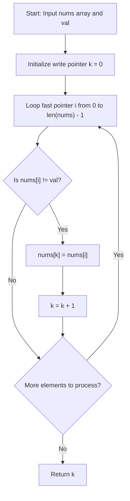

# 0027. Remove Element


---

## 1. Problem Information

- **Problem Name:** Remove Element
- **LeetCode Number:** 27
- **Difficulty:** Easy
- **Tags:** Array, Two Pointers
- **Language Used:** Python
- **Problem Link:** [LeetCode #27 - Remove Element](https://leetcode.com/problems/remove-element/)

---

## 2. Problem Overview

Given an integer array `nums` and an integer `val`, remove all occurrences of `val` in `nums` **in-place**. The order of the elements may be changed. Then return the number of elements in `nums` which are not equal to `val`.

Consider the number of elements in `nums` which are not equal to `val` to be $k$. To get accepted, you need to:
1. Modify the array `nums` such that the first $k$ elements contain the elements which are not equal to `val`.
2. The remaining elements beyond index $k - 1$ as well as the overall length of `nums` do not matter.
3. Return $k$.

### Custom Judge
The judge will test your solution with the following logic:
```java
int[] nums = [...]; // Input array
int val = ...; // Value to remove
int[] expectedNums = [...]; // The expected answer with correct length (sorted with no values equaling val).

int k = removeElement(nums, val); // Calls your implementation

assert k == expectedNums.length;
sort(nums, 0, k); // Sort the first k elements of nums
for (int i = 0; i < actualLength; i++) {
    assert nums[i] == expectedNums[i];
}
```

### Input & Output Specifications
- **Input:** 
  - `nums`: An integer array ($0 \le \text{nums.length} \le 100$).
  - `val`: An integer value to remove ($0 \le \text{val} \le 100$).
- **Output:** An integer $k$ representing the count of elements in `nums` not equal to `val`, with `nums[:k]` containing these valid elements.
- **Constraints:** $0 \le \text{nums}[i] \le 50$.

### Examples
- **Example 1:**
  - **Input:** `nums = [3,2,2,3], val = 3`
  - **Output:** `2, nums = [2,2,_,_]`
  - **Explanation:** Your function should return $k = 2$, with the first two elements of `nums` being 2. It does not matter what is left beyond index $k - 1$.
- **Example 2:**
  - **Input:** `nums = [0,1,2,2,3,0,4,2], val = 2`
  - **Output:** `5, nums = [0,1,4,0,3,_,_,_]`
  - **Explanation:** Your function should return $k = 5$, with the first five elements of `nums` containing 0, 1, 3, 0, and 4 (in any order).

---

## 3. Intuition

> [!TIP]
> **Fast / Slow Two Pointers In-Place Pattern:** Use a slow write pointer `k` to track the boundary of valid elements (those $\ne \text{val}$), and a fast read pointer `i` to inspect every element in the array.

### Why Two Pointers Work:
- Rather than shifting remaining elements backward every time `val` is found (which is slow and incurs an $\mathcal{O}(N^2)$ time penalty), we can simply **overwrite** elements in-place.
- The slow pointer `k` starts at `0`.
- The fast pointer `i` scans elements from index `0` to $N - 1$.
- Whenever `nums[i] != val`, we copy `nums[i]` to `nums[k]` and advance `k`.
- Whenever `nums[i] == val`, we simply skip it.
- When `i` finishes traversal, `k` represents the exact count of retained elements, and the subarray `nums[0:k]` contains all elements not equal to `val`.

```text
Input: nums = [0, 1, 2, 2, 3, 0, 4, 2], val = 2

i = 0: nums[0] = 0 (!= 2) -> nums[0] = 0, k -> 1
i = 1: nums[1] = 1 (!= 2) -> nums[1] = 1, k -> 2
i = 2: nums[2] = 2 (== 2) -> skip, k stays 2
i = 3: nums[3] = 2 (== 2) -> skip, k stays 2
i = 4: nums[4] = 3 (!= 2) -> nums[2] = 3, k -> 3
i = 5: nums[5] = 0 (!= 2) -> nums[3] = 0, k -> 4
i = 6: nums[6] = 4 (!= 2) -> nums[4] = 4, k -> 5
i = 7: nums[7] = 2 (== 2) -> skip, k stays 5

Result: k = 5, nums[:5] = [0, 1, 3, 0, 4]
```

---

## 4. Thought Process



1. **Pointer Initialization:**
   - Initialize slow write pointer `k = 0`.
2. **Fast Pointer Traversal:**
   - Loop `i` from `0` to `len(nums) - 1`:
     - If `nums[i] != val`:
       - Overwrite `nums[k] = nums[i]`
       - Increment `k += 1`
     - If `nums[i] == val`:
       - Disregard the element and continue.
3. **Return Value:**
   - Return `k` as the new valid length.

---

## 5. Concepts Used

### 1. Fast / Slow Two Pointers
- **What it is:** Maintaining two pointer indices where one reads input sequentially and the other writes filtered output into the same memory buffer.
- **Why it is used here:** Guarantees $\mathcal{O}(1)$ auxiliary space mutation without requiring dynamic memory allocation.
- **Future applications:** LeetCode #26 (Remove Duplicates from Sorted Array), LeetCode #283 (Move Zeroes), QuickSort partitioning.

### 2. In-Place Array Overwriting (Filtering)
- **What it is:** Overwriting obsolete data at index $k$ using valid data from index $i$ ($k \le i$).
- **Why it is used here:** Overwriting index $k$ never destroys unprocessed elements because the read pointer $i$ is always ahead of or equal to $k$.

---

## 6. Algorithm Used

### Two Pointers In-Place Array Filtering

- **Algorithm Category:** Array / Two Pointers
- **Why selected:** Achieves the theoretical lower bound for time complexity $\mathcal{O}(N)$ while maintaining $\mathcal{O}(1)$ auxiliary space.
- **Time Complexity:** $\mathcal{O}(N)$
- **Space Complexity:** $\mathcal{O}(1)$ auxiliary space

---

## 7. Code Walkthrough

Below is the line-by-line breakdown of the Python solution:

```python
class Solution(object):
    def removeElement(self, nums, val):
        """
        :type nums: List[int]
        :type val: int
        :rtype: int
        """
        # Line 1: Initialize write pointer k at index 0
        k = 0

        # Line 2: Traverse array using read pointer i
        for i in range(len(nums)):

            # Line 3: If current element does not match val
            if nums[i] != val:

                # Line 4: Copy element to position k
                nums[k] = nums[i]

                # Line 5: Increment write pointer
                k += 1

        # Line 6: Return the count of valid elements
        return k
```

---

## 8. Dry Run

Let's dry run for `nums = [0, 1, 2, 2, 3, 0, 4, 2]` with `val = 2`.

### Setup
- `nums = [0, 1, 2, 2, 3, 0, 4, 2]`
- `val = 2`
- Initial `k = 0`

### Step-by-Step Execution Trace

| `i` | `nums[i]` | `nums[i] != val` | Action | `nums` State | `k` after step |
| :---: | :---: | :---: | :--- | :--- | :---: |
| **0** | 0 | **True** | `nums[0] = 0`, `k++` | `[0, 1, 2, 2, 3, 0, 4, 2]` | **1** |
| **1** | 1 | **True** | `nums[1] = 1`, `k++` | `[0, 1, 2, 2, 3, 0, 4, 2]` | **2** |
| **2** | 2 | False | Skip (matches `val`) | `[0, 1, 2, 2, 3, 0, 4, 2]` | 2 |
| **3** | 2 | False | Skip (matches `val`) | `[0, 1, 2, 2, 3, 0, 4, 2]` | 2 |
| **4** | 3 | **True** | `nums[2] = 3`, `k++` | `[0, 1, 3, 2, 3, 0, 4, 2]` | **3** |
| **5** | 0 | **True** | `nums[3] = 0`, `k++` | `[0, 1, 3, 0, 3, 0, 4, 2]` | **4** |
| **6** | 4 | **True** | `nums[4] = 4`, `k++` | `[0, 1, 3, 0, 4, 0, 4, 2]` | **5** |
| **7** | 2 | False | Skip (matches `val`) | `[0, 1, 3, 0, 4, 0, 4, 2]` | 5 |

### Final Result
- Function returns **`k = 5`**.
- Prefix `nums[:5]` is `[0, 1, 3, 0, 4]`, which matches expected elements without any occurrence of `2`.

---

## 9. Complexity Analysis

### Time Complexity: $\mathcal{O}(N)$
- $N$ is the number of elements in `nums`.
- We iterate through the array of size $N$ exactly once using pointer `i`.
- In each step, comparisons and assignments take constant time $\mathcal{O}(1)$.
- Total time complexity is strictly linear: $\mathcal{O}(N)$.

### Space Complexity: $\mathcal{O}(1)$ Auxiliary Space
- The array `nums` is modified entirely in-place.
- Only two integer variables (`k` and `i`) are utilized.
- No dynamic memory or auxiliary containers are allocated.
- Auxiliary space complexity is $\mathcal{O}(1)$.

---

## 10. Edge Cases

| Edge Case Scenario | Input Example | Output | How Code Handles It |
| :--- | :--- | :--- | :--- |
| **Empty Array** | `nums = [], val = 0` | `k = 0, []` | Loop range is `range(0)` (does not execute), returns `k = 0`. |
| **All Elements Match `val`** | `nums = [2, 2, 2], val = 2` | `k = 0, [...]` | Condition `nums[i] != val` is never met; `k` remains `0`. |
| **No Elements Match `val`** | `nums = [1, 2, 3], val = 4` | `k = 3, [1, 2, 3]` | Every element copied to its own index; returns full length $k = 3$. |
| **Single Element (Match)** | `nums = [1], val = 1` | `k = 0, [...]` | Skips element, returns `k = 0`. |
| **Single Element (No Match)** | `nums = [1], val = 2` | `k = 1, [1]` | Copies `nums[0] = 1`, increments `k` to 1, returns `k = 1`. |

---

## 11. Alternative Approaches

### Approach 1: Extra Array / List Filtering ($\mathcal{O}(N)$ Time, $\mathcal{O}(N)$ Space)
- **Idea:** Create a new list `nums = [x for x in nums if x != val]` and copy elements back.
- **Drawback:** Requires $\mathcal{O}(N)$ auxiliary memory, violating the strict in-place $\mathcal{O}(1)$ space constraint required by the problem.

### Approach 2: Two Pointers from Opposite Ends (Swap with Last Element) ($\mathcal{O}(N)$ Time, $\mathcal{O}(1)$ Space)
- **Idea:** When `nums[i] == val`, swap `nums[i]` with the last element `nums[n - 1]` and reduce array size `n -= 1`. Do not increment `i` so the swapped element can be evaluated.
- **Advantage:** Ideal when elements to remove are very rare (minimizes number of write assignments).
- **Drawback:** Changes the relative ordering of elements.

### Approach 3: Two Pointers Fast/Slow (Current Solution - Recommended)
- **Idea:** Sequential read-and-overwrite.
- **Advantage:** Maintains relative order of retained elements, straightforward to reason about, and achieves optimal $\mathcal{O}(N)$ time and $\mathcal{O}(1)$ space.

---

## 12. Common Mistakes

> [!WARNING]
> 1. **Using `nums.remove(val)` Inside a Loop:** In Python, `nums.remove(val)` is an $\mathcal{O}(N)$ operation. Running it in a loop results in an inefficient $\mathcal{O}(N^2)$ solution.
> 2. **Modifying List During Standard Iteration:** Using `for x in nums: if x == val: nums.remove(x)` modifies the underlying collection while iterating, which skips subsequent adjacent elements.
> 3. **Confusing Return Value with the Array:** The method must return the integer count $k$, while mutating `nums` in-place. Returning a new list will fail the LeetCode judge assertion.

---

## 13. Interview Questions

1. **Q: How does this problem differ from LeetCode #26 (Remove Duplicates from Sorted Array)?**
   - *A:* In LeetCode #26, the array is sorted and duplicate elements are adjacent, so we compare `nums[i]` with `nums[i-1]`. In LeetCode #27, the array is unsorted and we compare each element against a specific target `val`.
2. **Q: When would you prefer swapping with the end element instead of the fast/slow pointer method?**
   - *A:* When the elements to remove are extremely rare (e.g., array length is 100,000 and `val` appears only twice). Swapping with the last element requires only 2 write operations, whereas fast/slow pointers copy all 99,998 elements.
3. **Q: Why does overwriting `nums[k]` with `nums[i]` never overwrite an unprocessed valid element?**
   - *A:* Because the write pointer `k` starts at 0 and increments at most once per iteration ($k \le i$ at all times). Thus, `k` never overtakes `i`.

---

## 14. Similar Problems

- **Easy:**
  - [LeetCode #26 - Remove Duplicates from Sorted Array](https://leetcode.com/problems/remove-duplicates-from-sorted-array/)
  - [LeetCode #283 - Move Zeroes](https://leetcode.com/problems/move-zeroes/)
- **Medium:**
  - [LeetCode #80 - Remove Duplicates from Sorted Array II](https://leetcode.com/problems/remove-duplicates-from-sorted-array-ii/)

---

## 15. Learning Summary

- **Pattern Recognized:** In-Place Array Mutation using Fast/Slow Read-Write Pointers.
- **Overwriting Strategy:** Overwrite obsolete elements rather than shifting elements backwards.
- **Space Efficiency:** Achieving $\mathcal{O}(1)$ auxiliary memory by reusing the input array buffer.

---

## 16. Optimization Notes

Your solution is **100% optimal** ($\mathcal{O}(N)$ Time, $\mathcal{O}(1)$ Auxiliary Space). It executes in a single linear pass and satisfies all constraints.
