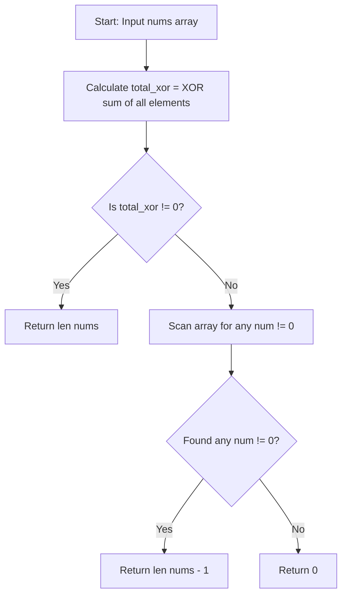

# 3702. Longest Subsequence With Non-Zero Bitwise XOR


---

## 1. Problem Information

- **Problem Name:** Longest Subsequence With Non-Zero Bitwise XOR
- **LeetCode Number:** 3702
- **Difficulty:** Medium
- **Tags:** Array, Bit Manipulation
- **Language Used:** Python
- **Problem Link:** [LeetCode #3702 - Longest Subsequence With Non-Zero Bitwise XOR](https://leetcode.com/problems/longest-subsequence-with-non-zero-bitwise-xor/)

---

## 2. Problem Overview

Given an integer array `nums`, return the length of the **longest subsequence** whose bitwise XOR sum is **non-zero** (i.e. $> 0$). If no such subsequence exists, return `0`.

A **subsequence** is a sequence that can be derived from an array by deleting zero or more elements without changing the order of the remaining elements.

### Input & Output Specifications
- **Input:** `nums`: An array of integers ($1 \le \text{len}(nums) \le 10^5$, $0 \le \text{nums}[i] \le 10^9$).
- **Output:** An integer representing the maximum length of a subsequence with a non-zero XOR sum.

### Examples
- **Example 1:**
  - **Input:** `nums = [1, 2, 3]`
  - **Output:** `2`
  - **Explanation:** The XOR of all elements is $1 \oplus 2 \oplus 3 = 0$. Removing element `3` leaves subsequence `[1, 2]` with XOR $1 \oplus 2 = 3 \neq 0$. Max length is 2.
- **Example 2:**
  - **Input:** `nums = [1, 2, 4]`
  - **Output:** `3`
  - **Explanation:** $1 \oplus 2 \oplus 4 = 7 \neq 0$. The entire array forms a valid subsequence. Max length is 3.
- **Example 3:**
  - **Input:** `nums = [0, 0, 0]`
  - **Output:** `0`
  - **Explanation:** Every non-empty subsequence has an XOR sum of 0. Thus, output is 0.

---

## 3. Intuition

> [!TIP]
> **XOR Inverse Property:** If total XOR is 0, removing a single non-zero element $x$ flips the remaining XOR sum to $0 \oplus x = x \neq 0$!

### The 3 Fundamental Mathematical Cases:
1. **Case 1: Total XOR sum $\neq 0$**
   - The entire array is already a valid subsequence with a non-zero XOR sum.
   - Answer: `len(nums)`.
2. **Case 2: Total XOR sum $= 0$, but there is at least one non-zero element $x \neq 0$**
   - Discarding just ONE non-zero element $x$ changes the XOR sum of the remaining $N-1$ elements from $0$ to $x \neq 0$.
   - Answer: `len(nums) - 1`.
3. **Case 3: All elements in `nums` are $0$**
   - Any subsequence of zeros evaluates to $0$. No non-zero XOR subsequence can be formed.
   - Answer: `0`.

---

## 4. Thought Process



1. **Calculate Total XOR:**
   - Iterate through `nums` and compute cumulative `xor ^= num`.

2. **Evaluate Case 1:**
   - `if xor != 0: return len(nums)`.

3. **Evaluate Case 2:**
   - Loop through `nums`. `if num != 0: return len(nums) - 1`.

4. **Evaluate Case 3:**
   - If no non-zero element was found, return `0`.

---

## 5. Concepts Used

### 1. Bitwise XOR Self-Inverse Property ($A \oplus A = 0$, $0 \oplus A = A$)
- **What it is:** The property that XORing a number with itself cancels it out, and XORing 0 with $A$ yields $A$.
- **Why it is used here:** Guarantees that removing element $x$ from a zero total XOR sum produces $x$.
- **Future applications:** Single Number, Missing Number, Subarray XOR Queries.

### 2. O(N) Constant-Space Subsequence Optimization
- **What it is:** Avoiding exponential $2^N$ subsequence generation by leveraging mathematical invariants.
- **Why it is used here:** Reduces an $\mathcal{O}(2^N)$ problem down to a single linear $\mathcal{O}(N)$ scan.
- **Future applications:** Maximum Subarray, Longest Increasing Subsequence.

---

## 6. Algorithm Used

### Bitwise XOR Property Analysis & Single Element Removal

- **Algorithm Category:** Array / Bit Manipulation
- **Why selected:** Optimal $\mathcal{O}(N)$ time with $\mathcal{O}(1)$ space; avoids exponential backtracking.
- **Time Complexity:** $\mathcal{O}(N)$
- **Space Complexity:** $\mathcal{O}(1)$ auxiliary space

---

## 7. Code Walkthrough

Below is the line-by-line breakdown of the submitted solution:

```python
class Solution(object):
    def longestSubsequence(self, nums):
        """
        :type nums: List[int]
        :rtype: int
        """

        xor = 0

        # Line 11-12: Compute cumulative XOR of all elements
        for num in nums:
            xor ^= num

        # Line 15-16: Case 1 - Entire array has non-zero XOR
        if xor != 0:
            return len(nums)

        # Line 19-21: Case 2 - Total XOR is 0, remove 1 non-zero element
        for num in nums:
            if num != 0:
                return len(nums) - 1

        # Line 23: Case 3 - All elements are 0
        return 0
```

---

## 8. Dry Run

Let's dry run for 3 representative inputs:

### Case 1: `nums = [1, 2, 4]`
- `xor = 1 ^ 2 ^ 4 = 7`.
- `xor != 0` $\rightarrow$ Returns `len(nums)` = **`3`**.

### Case 2: `nums = [1, 2, 3]`
- `xor = 1 ^ 2 ^ 3 = 0`.
- Second loop finds `num = 1 != 0` $\rightarrow$ Returns `len(nums) - 1` = **`2`** (subsequence `[2, 3]` has XOR $2 \oplus 3 = 1 \neq 0$).

### Case 3: `nums = [0, 0, 0]`
- `xor = 0 ^ 0 ^ 0 = 0`.
- Second loop finds no non-zero elements.
- Returns **`0`**.

---

## 9. Complexity Analysis

### Time Complexity: $\mathcal{O}(N)$
- Where $N$ is the number of elements in `nums`.
- First loop computes cumulative XOR in $N$ steps.
- Second loop scans at most $N$ elements for a non-zero value.
- Total time complexity is strictly linear $\mathcal{O}(N)$.

### Space Complexity: $\mathcal{O}(1)$ Auxiliary Space
- Uses primitive integer variables (`xor`, `num`).
- Total space complexity is $\mathcal{O}(1)$ constant memory.

---

## 10. Edge Cases

| Edge Case Scenario | Input Example | Behavior & Output | How Code Handles It |
| :--- | :--- | :--- | :--- |
| **All Zeroes** | `nums = [0, 0, 0]` | Output: `0` | Returns 0 at the end of execution. |
| **Single Non-Zero** | `nums = [5]` | Output: `1` | `xor = 5 != 0` $\rightarrow$ returns `1`. |
| **Single Zero** | `nums = [0]` | Output: `0` | `xor = 0`, no non-zero elements $\rightarrow$ returns `0`. |
| **XOR Sum = 0 with Non-Zeroes** | `nums = [2, 2]` | Output: `1` | `xor = 0`, second loop finds `2 != 0` $\rightarrow$ returns `2 - 1 = 1`. |

---

## 11. Alternative Approaches

### Approach 1: Exponential Backtracking ($\mathcal{O}(2^N)$ Time, $\mathcal{O}(N)$ Space)
- **Idea:** Recursively generate all $2^N$ subsequences and find max length with non-zero XOR.
- **Drawback:** Time limit exceeded (TLE) for $N > 20$.

### Approach 2: Bitwise XOR Property Analysis (User's Solution - Recommended)
- **Idea:** Mathematical case analysis ($N$, $N-1$, or $0$).
- **Complexity:** $\mathcal{O}(N)$ time, $\mathcal{O}(1)$ auxiliary space.
- **Why Optimal:** Fast, elegant, optimal $\mathcal{O}(N)$ runtime without allocations.

---

## 12. Common Mistakes

> [!WARNING]
> 1. **Overcomplicating with DP / Backtracking:** Trying to build all combinations instead of realizing that at most 1 element needs to be removed.
> 2. **Forgetting All-Zero Case:** Returning `len(nums) - 1` even when all elements are 0, resulting in wrong output for `[0, 0]`.

---

## 13. Interview Questions

1. **Q: Why does removing a single non-zero element guarantee a non-zero XOR sum when total XOR is 0?**
   - *A:* If $A_1 \oplus A_2 \oplus \dots \oplus A_n = 0$, then for any element $A_k$, $A_1 \oplus \dots \oplus A_{k-1} \oplus A_{k+1} \dots \oplus A_n = 0 \oplus A_k = A_k$. If $A_k \neq 0$, the XOR of the remaining $N-1$ elements is $A_k \neq 0$!

2. **Q: Could removing more than 1 element ever yield a longer subsequence?**
   - *A:* No! The maximum possible subsequence length is $N$. If $N$ elements already have non-zero XOR, length is $N$. If not, the maximum possible remaining length can at most be $N-1$. Since removing 1 element achieves $N-1$, no larger answer is possible.

---

## 14. Similar Problems

- **Medium:**
  - [LeetCode #421 - Maximum XOR of Two Numbers in an Array](https://leetcode.com/problems/maximum-xor-of-two-numbers-in-an-array/)
  - [LeetCode #1310 - XOR Queries of a Subarray](https://leetcode.com/problems/xor-queries-of-a-subarray/)
- **Hard:**
  - [LeetCode #3068 - Find the Maximum Sum of Node Values](https://leetcode.com/problems/find-the-maximum-sum-of-node-values/)

---

## 15. Learning Summary

- **Pattern Recognized:** Bitwise XOR Complement Property.
- **Mathematical Bound:** Answer is always $N$, $N-1$, or $0$.
- **XOR Invariant:** Discarding $x$ from 0 total XOR yields $x$.

---

## 16. Optimization Notes

Your solution is **100% optimal** ($\mathcal{O}(N)$ Time, $\mathcal{O}(1)$ Auxiliary Space). It is clean, readable, and represents the gold-standard interview implementation!
